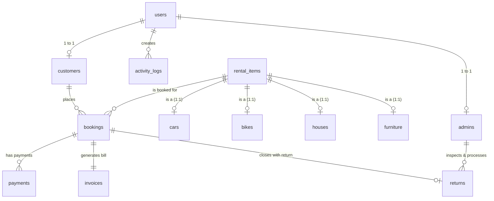

# Database Design Document: Smart Rental Management System

**Database Engine:** MySQL 8.0 Community Server (InnoDB Engine)  
**Database Name:** `smart_rental_db`  
**Character Set & Collation:** `utf8mb4` / `utf8mb4_unicode_ci`  
**Primary Management Tool:** MySQL Workbench 8.0  

---

## 1. Executive Overview

The **Smart Rental Management System** database is designed specifically for an enterprise multi-category rental platform handling four distinct rental domains:
1. **Automobile Rental (Cars)**
2. **Two-Wheeler Rental (Bikes & Scooters)**
3. **Real Estate Rental (Houses, Apartments & Villas)**
4. **Furnishing Rental (Home & Office Furniture)**

The design combines **Single Table Inheritance / Polymorphic Base Class mapping** with specialized extension tables (`cars`, `bikes`, `houses`, `furniture`), enforcing strict referential integrity, ACID transactional compliance, prepared statement safety, and financial audit trails.

---

## 2. Entity-Relationship (ER) Architecture

---

## 3. Relational Schema Specifications

### 3.1 Account & Role Management

#### Table: `users`
Stores unified authentication credentials and base account status. Passwords are stored exclusively as cryptographic hashes (SHA-256 / PBKDF2).
* `id` (`INT AUTO_INCREMENT PRIMARY KEY`): Unique user identifier.
* `email` (`VARCHAR(191) NOT NULL UNIQUE`): Primary login identity.
* `password_hash` (`VARCHAR(255) NOT NULL`): Cryptographic password hash.
* `role` (`ENUM('customer', 'admin') NOT NULL DEFAULT 'customer'`): Role-based access control.
* `is_active` (`TINYINT(1) NOT NULL DEFAULT 1`): Account activation flag (1 = Active, 0 = Suspended).
* `created_at` (`TIMESTAMP DEFAULT CURRENT_TIMESTAMP`): Account creation time.
* `updated_at` (`TIMESTAMP DEFAULT CURRENT_TIMESTAMP ON UPDATE CURRENT_TIMESTAMP`): Last modified time.

#### Table: `customers`
Extends `users` with profile and identity verification details for renters.
* `id` (`INT AUTO_INCREMENT PRIMARY KEY`): Unique customer ID.
* `user_id` (`INT NOT NULL UNIQUE`): Foreign key referencing `users(id)` (`ON DELETE CASCADE`).
* `full_name` (`VARCHAR(120) NOT NULL`): Legal full name.
* `phone` (`VARCHAR(20) NOT NULL`): Mobile contact number.
* `address` (`TEXT NOT NULL`): Residential physical address.
* `id_proof_number` (`VARCHAR(50)`): Aadhaar / National ID reference.
* `driving_license_number` (`VARCHAR(50)`): Driver's license number (for vehicle categories).

#### Table: `admins`
Extends `users` for managerial and operational staff.
* `id` (`INT AUTO_INCREMENT PRIMARY KEY`): Unique administrator ID.
* `user_id` (`INT NOT NULL UNIQUE`): Foreign key referencing `users(id)` (`ON DELETE CASCADE`).
* `full_name` (`VARCHAR(120) NOT NULL`): Administrator name.
* `phone` (`VARCHAR(20)`): Office contact number.
* `department` (`VARCHAR(80) DEFAULT 'Operations'`): Department designation.

---

### 3.2 Polymorphic Rental Item Catalog

#### Table: `rental_items` (Base Entity)
Represents the base polymorphic class `RentalItem`. Contains fields common to every rental product.
* `id` (`INT AUTO_INCREMENT PRIMARY KEY`): Unique rental item catalog ID.
* `title` (`VARCHAR(200) NOT NULL`): Display name of the item.
* `category` (`ENUM('Car', 'Bike', 'House', 'Furniture') NOT NULL`): Category discriminator.
* `description` (`TEXT`): Detailed feature summary.
* `daily_rate` (`DECIMAL(10,2) NOT NULL`): Rental fee per calendar day (in INR ₹).
* `security_deposit` (`DECIMAL(10,2) NOT NULL DEFAULT 0.00`): Refundable security deposit.
* `location` (`VARCHAR(150) NOT NULL`): City or metro region where item is stationed.
* `status` (`ENUM('available', 'rented', 'maintenance', 'retired') NOT NULL DEFAULT 'available'`): Fleet availability status.
* `image_url` (`VARCHAR(500)`): Public HTTPS image asset link.

#### Specialized Sub-Tables (Hierarchical Inheritance)
1. **`cars`**: Stores vehicle-specific technical specifications (`brand`, `model`, `year`, `fuel_type`, `seating_capacity`, `transmission`, `registration_number`, `mileage`). Foreign key to `rental_items(id)` (`ON DELETE CASCADE`).
2. **`bikes`**: Stores two-wheeler specifications (`brand`, `model`, `year`, `engine_capacity_cc`, `bike_type`, `registration_number`, `helmet_included`). Foreign key to `rental_items(id)` (`ON DELETE CASCADE`).
3. **`houses`**: Stores real estate specifications (`property_type`, `bedrooms`, `bathrooms`, `furnishing`, `area_sqft`, `address_line`, `parking_available`). Foreign key to `rental_items(id)` (`ON DELETE CASCADE`).
4. **`furniture`**: Stores home & office furnishing specifications (`furniture_type`, `material`, `color`, `item_condition`, `dimensions`, `assembly_required`). Foreign key to `rental_items(id)` (`ON DELETE CASCADE`).

---

### 3.3 Transactional & Operational Tables

#### Table: `bookings`
* `id` (`INT AUTO_INCREMENT PRIMARY KEY`): Unique booking record ID.
* `booking_code` (`VARCHAR(50) NOT NULL UNIQUE`): Human-readable reference (e.g., `BK-2026-001`).
* `customer_id` (`INT NOT NULL`): Foreign key referencing `customers(id)`.
* `item_id` (`INT NOT NULL`): Foreign key referencing `rental_items(id)`.
* `start_date` (`DATE NOT NULL`): Rental schedule start date.
* `end_date` (`DATE NOT NULL`): Rental schedule end date.
* `rental_days` (`INT NOT NULL`): Calculated duration: $\max(1, \text{end\_date} - \text{start\_date})$.
* `daily_rate` (`DECIMAL(10,2) NOT NULL`): Snapshot of daily rate at booking time.
* `base_rent` (`DECIMAL(10,2) NOT NULL`): $\text{daily\_rate} \times \text{rental\_days}$.
* `discount_rate` (`DECIMAL(5,2) DEFAULT 0.00`): Tiered percentage discount (e.g., 5% for $\ge 5$ days, 10% for $\ge 7$ days, 15% for $\ge 14$ days).
* `discount_amount` (`DECIMAL(10,2) DEFAULT 0.00`): Computed monetary discount.
* `security_deposit` (`DECIMAL(10,2) NOT NULL`): Snapshot of refundable security deposit.
* `total_amount` (`DECIMAL(10,2) NOT NULL`): $(\text{base\_rent} - \text{discount}) + \text{security\_deposit}$.
* `booking_status` (`ENUM('pending', 'confirmed', 'active', 'completed', 'cancelled') NOT NULL DEFAULT 'pending'`).

#### Table: `payments`
* `id` (`INT AUTO_INCREMENT PRIMARY KEY`): Payment record ID.
* `transaction_id` (`VARCHAR(80) NOT NULL UNIQUE`): Unique transaction reference.
* `booking_id` (`INT NOT NULL`): Foreign key referencing `bookings(id)`.
* `customer_id` (`INT NOT NULL`): Foreign key referencing `customers(id)`.
* `amount` (`DECIMAL(10,2) NOT NULL`): Amount paid or refunded.
* `payment_method` (`ENUM('Cash', 'UPI Demo', 'Card Demo') NOT NULL`): Method used.
* `payment_type` (`ENUM('Rental Payment', 'Security Deposit', 'Late Fee', 'Damage Charge', 'Deposit Refund') NOT NULL`): Classification.
* `payment_status` (`ENUM('success', 'pending', 'failed', 'refunded') NOT NULL`): Outcome.
* `remarks` (`VARCHAR(255)`): Transaction notes.

#### Table: `invoices`
* `id` (`INT AUTO_INCREMENT PRIMARY KEY`): Invoice ID.
* `invoice_number` (`VARCHAR(60) NOT NULL UNIQUE`): Official invoice serial number.
* `booking_id` (`INT NOT NULL UNIQUE`): 1-to-1 link to `bookings(id)`.
* `issue_date` (`DATE NOT NULL`), `due_date` (`DATE NOT NULL`).
* `subtotal`, `discount_amount`, `tax_amount`, `security_deposit`, `total_amount`, `paid_amount`.
* `payment_status` (`ENUM('paid', 'partial', 'unpaid') NOT NULL DEFAULT 'unpaid'`).

#### Table: `returns`
Records return inspection and financial settlement upon check-in.
* `id` (`INT AUTO_INCREMENT PRIMARY KEY`).
* `booking_id` (`INT NOT NULL UNIQUE`): Foreign key referencing `bookings(id)`.
* `return_code` (`VARCHAR(60) NOT NULL UNIQUE`): Return receipt code (e.g., `RET-2026-0001`).
* `actual_return_date` (`DATE NOT NULL`): Day customer handed over item.
* `expected_return_date` (`DATE NOT NULL`): Originally scheduled end date.
* `overdue_days` (`INT NOT NULL DEFAULT 0`): Calculated late duration.
* `daily_late_fee` (`DECIMAL(10,2)`), `total_late_fee` (`DECIMAL(10,2)`).
* `damage_charges` (`DECIMAL(10,2) DEFAULT 0.00`).
* `item_condition` (`ENUM('Excellent', 'Good', 'Fair', 'Damaged')`).
* `deposit_refunded` (`DECIMAL(10,2)`): Net refund = $\text{Security Deposit} - (\text{Late Fee} + \text{Damage Charges})$.
* `processed_by_admin_id` (`INT`): Foreign key referencing `admins(id)`.

#### Table: `activity_logs`
Audit log recording every significant operational event (`USER_LOGIN`, `BOOKING_CREATE`, `PAYMENT_COMPLETE`, `ITEM_RETURN_PROCESS`, etc.).

---

## 4. How to Execute in MySQL Workbench

1. Launch **MySQL Workbench 8.0**.
2. Connect to your local MySQL instance (Default: `localhost:3306`, user: `root`).
3. Click **File -> Open SQL Script...** and select `SmartRentalManagement/database/schema.sql`.
4. Click the **Execute (Lightning Bolt)** icon. The script creates the `smart_rental_db` database, dedicated user `rental_user`, and all 13 tables with constraints.
5. Click **File -> Open SQL Script...** and select `SmartRentalManagement/database/seed.sql`.
6. Click the **Execute** icon. This populates all 40 rental items (10 cars, 10 bikes, 10 houses, 10 furniture items), 10 customers, 2 admins, sample bookings, payments, and invoices.
7. In the Schemas tab on the left, right-click `smart_rental_db` and select **Refresh All**. You will see all 13 tables populated and ready.
