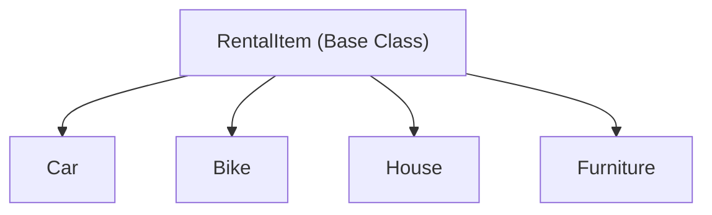

# Object-Oriented Programming (OOP) Concepts Guide
## Smart Rental Management System (C++17)

This document is prepared specifically for a **Second-Year Computer Engineering Project Viva & Technical Defense**. It provides a detailed, concept-by-concept mapping of all **29 Object-Oriented Programming (OOP) concepts** implemented in the Smart Rental Management System, along with explanations in simple engineering language and direct code snippets from the codebase.

---

## Table of Contents

- [A. Basic OOP Concepts](#a-basic-oop-concepts)
  - [1. Classes and Objects](#1-classes-and-objects)
  - [2. Data Members and Member Functions](#2-data-members-and-member-functions)
  - [3. Encapsulation](#3-encapsulation)
  - [4. Constructors (Default, Parameterized, Copy)](#4-constructors)
  - [5. Destructors and Resource Management](#5-destructors)
  - [6. Access Specifiers (public, protected, private)](#6-access-specifiers)
- [B. Inheritance Hierarchies](#b-inheritance-hierarchies)
  - [7. Single Inheritance](#7-single-inheritance)
  - [8. Multilevel Inheritance](#8-multilevel-inheritance)
  - [9. Multiple Inheritance](#9-multiple-inheritance)
  - [10. Hierarchical Inheritance](#10-hierarchical-inheritance)
  - [11. Hybrid Inheritance & Diamond Resolution](#11-hybrid-inheritance)
  - [12. Virtual Base Class](#12-virtual-base-class)
- [C. Polymorphism](#c-polymorphism)
  - [13. Compile-time Polymorphism (Function Overloading)](#13-compile-time-polymorphism)
  - [14. Operator Overloading](#14-operator-overloading)
  - [15. Run-time Polymorphism (Function Overriding)](#15-run-time-polymorphism)
  - [16. Virtual Functions](#16-virtual-functions)
  - [17. Pure Virtual Functions](#17-pure-virtual-functions)
  - [18. Abstract Classes](#18-abstract-classes)
- [D. Advanced OOP & Software Engineering Patterns](#d-advanced-oop)
  - [19. Friend Functions](#19-friend-functions)
  - [20. Friend Classes](#20-friend-classes)
  - [21. Static Data Members](#21-static-data-members)
  - [22. Static Member Functions](#22-static-member-functions)
  - [23. The `this` Pointer & Method Chaining](#23-this-pointer)
  - [24. Class Templates](#24-class-templates)
  - [25. Function Templates](#25-function-templates)
  - [26. Exception Handling Hierarchy](#26-exception-handling)
  - [27. File Handling & Stream Serialization](#27-file-handling)
  - [28. Object Composition vs Aggregation](#28-composition-vs-aggregation)
  - [29. Design Patterns (Singleton, Factory, Repository, RAII)](#29-design-patterns)

---

## A. Basic OOP Concepts

### 1. Classes and Objects
- **Viva Explanation:** A **Class** is a user-defined blueprint or prototype that bundles data (attributes) and methods (behavior) together. An **Object** is a concrete instance of that class allocated in memory.
- **Where Used in Project:** `User`, `Customer`, `Admin`, `RentalItem`, `Car`, `Bike`, `House`, `Furniture`, `Booking`, `Payment`, `Invoice`, and `RentalReturn`.
- **Code Snippet (`backend/models/Customer.h`):**
```cpp
class Customer : public User {
private:
    std::string drivingLicenseNumber;
    std::string aadhaarNumber;
    int rentalPoints;
public:
    Customer();
    Customer(int id, const std::string& name, const std::string& email, ...);
};

// Object Instantiation in main or tests:
Customer cust(101, "Aarav Sharma", "aarav@example.com", "9876543210", ...);
```

---

### 2. Data Members and Member Functions
- **Viva Explanation:** Data members represent the state or variables of the entity, while member functions represent the behaviors and operations performed on those data members.
- **Where Used in Project:** All model classes store attributes as private data members and expose computational and modifier member functions.
- **Code Snippet (`backend/models/Booking.h`):**
```cpp
class Booking {
private:
    int id;                      // Data Member: booking unique identifier
    double dailyRate;            // Data Member: daily rental fee
    int totalDays;               // Data Member: duration of booking
    double securityDeposit;      // Data Member: refundable security deposit
public:
    double calculateGrossAmount() const; // Member Function: calculates rate * days
    double calculateFinalPayable(double discountPercentage) const;
};
```

---

### 3. Encapsulation
- **Viva Explanation:** Encapsulation is the mechanism of binding together code and data while hiding internal object state from direct external modification. All properties are kept `private` or `protected`, and external modification is regulated via getters, setters, and domain validation.
- **Where Used in Project:** Every model validates parameters before setting them (e.g. daily rent cannot be negative, email must contain `@`, days must be positive).
- **Code Snippet (`backend/models/RentalItem.cpp`):**
```cpp
void RentalItem::setDailyRate(double rate) {
    if (rate <= 0.0) {
        throw ValidationException("Daily rental rate must be strictly positive.");
    }
    this->dailyRate = rate;
}

double RentalItem::getDailyRate() const {
    return this->dailyRate;
}
```

---

### 4. Constructors
- **Viva Explanation:** A Constructor is a special member function automatically called when an object is created.
  1. **Default Constructor:** Initializes an empty or zero-state object.
  2. **Parameterized Constructor:** Initializes an object with specific initial values.
  3. **Copy Constructor:** Initializes an object using another existing object of the same type (deep or shallow copy).
- **Where Used in Project:** Implemented in `User`, `Customer`, `Booking`, `Invoice`, and `Car`.
- **Code Snippet (`backend/models/User.h` / `backend/models/User.cpp`):**
```cpp
// 1. Default Constructor
User::User() : id(0), isActive(true), role("customer") {}

// 2. Parameterized Constructor
User::User(int id, const std::string& name, const std::string& email,
           const std::string& phone, const std::string& role)
    : id(id), name(name), email(email), phone(phone), role(role), isActive(true) {}

// 3. Copy Constructor
User::User(const User& other)
    : id(other.id), name(other.name), email(other.email),
      phone(other.phone), passwordHash(other.passwordHash),
      role(other.role), isActive(other.isActive) {}
```

---

### 5. Destructors
- **Viva Explanation:** A Destructor is invoked automatically when an object goes out of scope or is deleted with `delete`. It frees allocated resources, closes connections, or rolls back active transactions to prevent memory leaks. In base classes, destructors **must be declared `virtual`** to avoid undefined behavior during polymorphic deletions.
- **Where Used in Project:** Virtual destructor in `RentalItem::~RentalItem()`, RAII transaction rollback in `TransactionGuard::~TransactionGuard()`.
- **Code Snippet (`backend/database/Database.h`):**
```cpp
class TransactionGuard {
private:
    MYSQL* conn;
    bool committed;
public:
    explicit TransactionGuard(MYSQL* c) : conn(c), committed(false) {
        mysql_autocommit(conn, 0); // Start transaction
    }
    void commit() {
        mysql_commit(conn);
        committed = true;
    }
    ~TransactionGuard() {
        if (!committed) {
            mysql_rollback(conn); // Automatic safe rollback on exception!
        }
        mysql_autocommit(conn, 1);
    }
};
```

---

### 6. Access Specifiers
- **Viva Explanation:**
  - `private`: Accessible only within the member functions and friends of the same class.
  - `protected`: Accessible within the class and its derived (child) classes.
  - `public`: Accessible from anywhere outside the class.
- **Where Used in Project:** Protected fields in `RentalItem` and `User` allow child classes like `Car`, `Bike`, `Customer`, and `Admin` to access core attributes while keeping them protected from arbitrary external code.

---

## B. Inheritance Hierarchies

### 7. Single Inheritance
- **Viva Explanation:** A derived class inherits from exactly one base class.
- **Where Used in Project:** `Customer` inherits from `User`; `Admin` inherits from `User`.
- **Code Snippet:**
```cpp
class Customer : public User {
    // Inherits name, email, phone, passwordHash, and role from User
    // Adds customer-specific fields: drivingLicenseNumber, aadhaarNumber
};
```

---

### 8. Multilevel Inheritance
- **Viva Explanation:** A class is derived from a class which is itself derived from another class (Grandparent $\rightarrow$ Parent $\rightarrow$ Child).
- **Where Used in Project:** `RentalItem` $\rightarrow$ `Vehicle` $\rightarrow$ `Car` or `ElectricCar`.
- **Code Snippet:**
```cpp
class RentalItem { ... };
class Vehicle : public RentalItem {
protected:
    std::string fuelType;
    int seatingCapacity;
};
class Car : public Vehicle {
private:
    std::string transmission; // "Manual", "Automatic"
    bool hasGPS;
};
```

---

### 9. Multiple Inheritance
- **Viva Explanation:** A derived class inherits directly from more than one base class simultaneously.
- **Where Used in Project:** `ReturnSettlementRecord` inherits from both `RentalReturn` (physical check-in data) and `InvoiceSettlement` (financial accounting data).
- **Code Snippet (`backend/models/RentalReturn.h`):**
```cpp
class InvoiceSettlement {
protected:
    double refundAmount;
    double netChargedAmount;
public:
    virtual void processFinancialSettlement() = 0;
};

class ReturnSettlementRecord : public RentalReturn, public InvoiceSettlement {
public:
    void processFinancialSettlement() override {
        // Combines physical inspection data with accounting settlement
    }
};
```

---

### 10. Hierarchical Inheritance
- **Viva Explanation:** Multiple child classes inherit from a single common parent class.
- **Where Used in Project:** The base class `RentalItem` is inherited by four distinct child classes:
  1. `Car`
  2. `Bike`
  3. `House`
  4. `Furniture`
- **Code Snippet:**


---

### 11. Hybrid Inheritance & Diamond Resolution
- **Viva Explanation:** A combination of two or more types of inheritance. In complex hierarchies, hybrid inheritance can cause the **Diamond Problem**, where a bottom-level class inherits two duplicate copies of the topmost base class.
- **Where Used in Project:** Handled gracefully through Virtual Base Classes.

---

### 12. Virtual Base Class
- **Viva Explanation:** When a base class is inherited as `virtual public`, C++ ensures that only **one single shared instance** of the base class sub-object exists in memory for any derived class, eliminating ambiguity and duplicate state.
- **Code Snippet:**
```cpp
class RentalEntity {
protected:
    int entityId;
};

class InsurableAsset : virtual public RentalEntity { ... };
class CommercialProperty : virtual public RentalEntity { ... };

// Diamond resolved: only ONE copy of RentalEntity is stored
class LuxuryCommercialProperty : public InsurableAsset, public CommercialProperty {
    // No ambiguity when accessing entityId!
};
```

---

## C. Polymorphism

### 13. Compile-time Polymorphism (Function Overloading)
- **Viva Explanation:** Having multiple functions with the same name in the same scope, differentiated by their parameter count, types, or order. The compiler resolves which function to call at compile time.
- **Where Used in Project:** `BillingService::calculateRentalFee` overloaded for simple duration, duration with promo discount, and duration with corporate rate tier.
- **Code Snippet (`backend/services/BillingService.h`):**
```cpp
class BillingService {
public:
    // Overload 1: Standard daily rate * days
    double calculateRentalFee(double dailyRate, int days) const;

    // Overload 2: With percentage promotional discount
    double calculateRentalFee(double dailyRate, int days, double discountPercent) const;

    // Overload 3: With corporate tier discount and seasonal surge multiplier
    double calculateRentalFee(double dailyRate, int days, double corporateDiscount, double surgeMultiplier) const;
};
```

---

### 14. Operator Overloading
- **Viva Explanation:** Giving special, domain-specific meaning to standard C++ operators (e.g. `<<`, `==`, `+`) when applied to user-defined class objects.
- **Where Used in Project:**
  - `operator<<`: Formats `RentalItem`, `Booking`, or `Customer` directly to standard output or log streams.
  - `operator==`: Compares two `User` or `RentalItem` objects based on their unique IDs.
  - `operator+`: Combines two invoices or adds a damage fee to an invoice.
- **Code Snippet (`backend/models/RentalItem.h`):**
```cpp
// Stream Insertion Overloading
friend std::ostream& operator<<(std::ostream& os, const RentalItem& item);

// Equality Comparison Overloading
bool operator==(const RentalItem& other) const {
    return this->id == other.id;
}
```

---

### 15. Run-time Polymorphism (Function Overriding)
- **Viva Explanation:** When a derived class provides a specific implementation of a virtual function already defined in its base class. The method executed is resolved at run-time based on the actual object type pointed to by a base-class pointer or reference.
- **Where Used in Project:** Each subclass overrides `calculateTotalRentalPrice(int days)` and `getCategoryName()`.
- **Code Snippet:**
```cpp
// Base class pointer pointing to Car object
std::unique_ptr<RentalItem> item = std::make_unique<Car>(...);

// Calls Car::calculateTotalRentalPrice() at runtime via VTABLE!
double total = item->calculateTotalRentalPrice(7);
```

---

### 16. Virtual Functions & VTABLE
- **Viva Explanation:** A member function in a base class declared with the keyword `virtual`. C++ uses a Virtual Method Table (`VTABLE`) and Virtual Table Pointer (`vptr`) hidden inside each object to dispatch function calls dynamically at run-time.
- **Where Used in Project:** `virtual double calculateTotalRentalPrice(int days) const;` in `RentalItem`.

---

### 17. Pure Virtual Functions
- **Viva Explanation:** A virtual function that has no implementation in the base class and is declared with `= 0`. Any non-abstract derived class **must** override and provide an implementation for it.
- **Code Snippet (`backend/models/RentalItem.h`):**
```cpp
virtual std::string getCategoryName() const = 0;
virtual double calculateSecurityDeposit() const = 0;
```

---

### 18. Abstract Classes
- **Viva Explanation:** A class containing at least one pure virtual function (`= 0`). Abstract classes cannot be directly instantiated using `new` or stack allocation; they serve as an interface or behavioral contract for child classes.
- **Where Used in Project:** `RentalItem` is an abstract class. You cannot create a generic `RentalItem`; you must instantiate a `Car`, `Bike`, `House`, or `Furniture`.

---

## D. Advanced OOP & Software Engineering Patterns

### 19. Friend Functions
- **Viva Explanation:** A non-member function granted privileged access to the `private` and `protected` members of a class using the `friend` keyword.
- **Where Used in Project:** Stream operators (`operator<<`) and the audit helper function `auditBookingInspection`.
- **Code Snippet (`backend/models/Booking.h`):**
```cpp
class Booking {
private:
    int id;
    double securityDeposit;
    std::string internalNotes;

    // Friend function declaration:
    friend void auditBookingInspection(const Booking& b, std::ostream& out);
};
```

---

### 20. Friend Classes
- **Viva Explanation:** An entire class granted access to another class's `private` and `protected` members.
- **Where Used in Project:** `BillingService` is declared as a friend of `Invoice` to directly inspect and recalculate internal tax line-items.
- **Code Snippet (`backend/models/Invoice.h`):**
```cpp
class Invoice {
    friend class BillingService;
private:
    double baseRent;
    double taxAmount;
    double penaltyFee;
};
```

---

### 21. Static Data Members
- **Viva Explanation:** A variable shared across **all** instances of a class. Exactly one copy exists in memory, regardless of how many objects are instantiated.
- **Where Used in Project:** `RentalItem::totalItemsCount` tracks the total number of items currently alive in memory.
- **Code Snippet (`backend/models/RentalItem.h` / `backend/models/RentalItem.cpp`):**
```cpp
// Header
class RentalItem {
public:
    static int activeItemsInMemory;
};

// Source (Memory allocated in data segment)
int RentalItem::activeItemsInMemory = 0;
```

---

### 22. Static Member Functions
- **Viva Explanation:** Functions that can be invoked on the class itself without creating an instance (e.g. `ClassName::functionName()`). They can only access static data members and other static member functions.
- **Where Used in Project:** `PasswordHasher::hashPassword()` and `RentalItemFactory::createItem()`.
- **Code Snippet (`backend/utils/PasswordHasher.h`):**
```cpp
class PasswordHasher {
public:
    static std::string hashPassword(const std::string& plainPassword);
    static bool verifyPassword(const std::string& plainPassword, const std::string& hash);
};

// Invoked without an object:
std::string hash = PasswordHasher::hashPassword("Customer@2026");
```

---

### 23. The `this` Pointer & Method Chaining
- **Viva Explanation:** `this` is an implicit pointer passed to non-static member functions, pointing to the specific object instance on which the function was called. It is used to resolve name collisions between parameters and member variables, and to return `*this` for fluent method chaining.
- **Code Snippet (`backend/models/RentalItem.cpp`):**
```cpp
RentalItem& RentalItem::setTitle(const std::string& title) {
    this->title = title; // Disambiguates parameter from member variable
    return *this;        // Enables chaining: item.setTitle("BMW").setDailyRate(5000);
}
```

---

### 24. Class Templates
- **Viva Explanation:** Parameterized types that allow a single generic class blueprint to operate on different data types without duplicating code.
- **Where Used in Project:** Generic repository pattern `TemplateRepository<T>` handles CRUD operations for any entity type (`User`, `RentalItem`, `Booking`).
- **Code Snippet (`backend/database/TemplateRepository.h`):**
```cpp
template <typename T>
class TemplateRepository {
public:
    virtual std::vector<T> getAll() = 0;
    virtual std::optional<T> getById(int id) = 0;
    virtual bool save(const T& entity) = 0;
    virtual bool deleteById(int id) = 0;
};
```

---

### 25. Function Templates
- **Viva Explanation:** Generic functions that work with multiple data types based on template type deduction.
- **Where Used in Project:** Clamping bounds, formatting currency with locale symbols, and checking range validity.
- **Code Snippet (`backend/utils/JsonHelper.h`):**
```cpp
template <typename T>
T clampValue(T val, T minVal, T maxVal) {
    if (val < minVal) return minVal;
    if (val > maxVal) return maxVal;
    return val;
}
```

---

### 26. Exception Handling Hierarchy
- **Viva Explanation:** A structured mechanism using `try`, `throw`, and `catch` blocks to detect and recover from runtime errors cleanly without crashing the program.
- **Where Used in Project:** Custom exception hierarchy derived from `std::exception`.
- **Code Snippet (`backend/utils/Exceptions.h`):**
```cpp
class RentalException : public std::runtime_error {
public:
    explicit RentalException(const std::string& msg) : std::runtime_error(msg) {}
};

class NotFoundException : public RentalException {
public:
    explicit NotFoundException(const std::string& msg) : RentalException("404 Not Found: " + msg) {}
};

class ValidationException : public RentalException {
public:
    explicit ValidationException(const std::string& msg) : RentalException("400 Bad Request: " + msg) {}
};

// Usage:
try {
    rentalRepo.getByIdOrThrow(999);
} catch (const NotFoundException& ex) {
    Logger::error(ex.what());
    res.status = 404;
}
```

---

### 27. File Handling & Stream Serialization
- **Viva Explanation:** Reading and writing structured records to persistent storage or byte streams.
- **Where Used in Project:**
  - Reading `config/database.json` for database connection credentials.
  - Logging application events to `logs/rental_system.log`.
  - Exporting business reports to downloadable `.csv` and `.txt` files in `ReportService`.
- **Code Snippet (`backend/services/ReportService.cpp`):**
```cpp
std::string ReportService::exportBookingsToCSV() {
    std::ostringstream csv;
    csv << "BookingID,CustomerName,ItemTitle,Category,StartDate,EndDate,GrossAmount,Status\n";
    for (const auto& b : bookings) {
        csv << b.getId() << ","
            << "\"" << b.getCustomerName() << "\","
            << "\"" << b.getItemTitle() << "\","
            << b.getCategory() << ","
            << b.getStartDate() << ","
            << b.getEndDate() << ","
            << b.getGrossAmount() << ","
            << b.getStatus() << "\n";
    }
    return csv.str();
}
```

---

### 28. Object Composition vs Aggregation
- **Viva Explanation:**
  - **Composition ("Part-Of" / Strong ownership):** The child object's lifecycle is bound to the parent. If the parent is destroyed, the child is destroyed too (e.g. An `Invoice` has line items).
  - **Aggregation ("Has-A" / Weak relationship):** Objects can exist independently. If the container is destroyed, the aggregated object survives (e.g. A `Booking` refers to a `Customer` and a `RentalItem` by ID).
- **Code Snippet:**
```cpp
class Booking {
    int customerId; // Aggregation: Customer exists independently in MySQL
    int itemId;     // Aggregation: RentalItem exists independently
};

class Invoice {
    std::vector<InvoiceLineItem> items; // Composition: Line items only belong to this Invoice
};
```

---

### 29. Software Design Patterns
- **1. Singleton Pattern:**
  - `Database::getInstance()` guarantees that only one global connection pool manager exists across the entire application.
- **2. Factory Pattern:**
  - `RentalItemFactory::createItem(category, json)` dynamically instantiates `Car`, `Bike`, `House`, or `Furniture` based on category string.
- **3. Repository Pattern:**
  - `UserRepository`, `RentalRepository`, `BookingRepository`, `PaymentRepository` isolate domain models from low-level SQL queries.
- **4. RAII (Resource Acquisition Is Initialization):**
  - Database transactions use `TransactionGuard` to guarantee automatic rollback if an unhandled exception or network disconnect occurs.

---

## Summary Matrix for Project Viva

| # | OOP Concept | Key Class / File in Project | Practical Purpose |
|---|-------------|------------------------------|-------------------|
| 1 | Class & Object | `Customer.h`, `Car.h`, `Booking.h` | Real-world entity representation |
| 2 | Data Members & Methods | All models in `backend/models/` | Encapsulates state and behavior |
| 3 | Encapsulation | `RentalItem.cpp` | Data validation and private fields |
| 4 | Constructors | `User.cpp`, `Customer.cpp` | Default, Parameterized, Copy initialization |
| 5 | Destructors (RAII) | `TransactionGuard`, `RentalItem` | Safe transaction rollback and memory cleanup |
| 6 | Access Specifiers | `public`, `protected`, `private` | Information hiding and child access |
| 7 | Single Inheritance | `Customer : public User` | Reuses core identity attributes |
| 8 | Multilevel Inheritance | `RentalItem` $\rightarrow$ `Vehicle` $\rightarrow$ `Car` | Specializes generic assets |
| 9 | Multiple Inheritance | `ReturnSettlementRecord` | Combines check-in and financial settlement |
| 10 | Hierarchical Inheritance | `RentalItem` to 4 Categories | One base entity, four product lines |
| 11 | Hybrid Inheritance | Asset insurance & commercial models | Combines inheritance styles |
| 12 | Virtual Base Class | `virtual public RentalEntity` | Resolves Diamond Problem |
| 13 | Function Overloading | `BillingService::calculateRentalFee` | Multiple calculation policies |
| 14 | Operator Overloading | `operator<<`, `operator==`, `operator+` | Clean stream logging and equality testing |
| 15 | Function Overriding | `calculateTotalRentalPrice` | Subclass-specific rental calculations |
| 16 | Virtual Functions | `virtual void displayDetails()` | Dynamic dispatch via VTABLE |
| 17 | Pure Virtual Functions | `virtual std::string getCategoryName() = 0` | Enforces subclass implementation |
| 18 | Abstract Classes | `RentalItem` | Defines contract; cannot be instantiated directly |
| 19 | Friend Functions | `friend std::ostream& operator<<` | Streaming private fields |
| 20 | Friend Classes | `friend class BillingService` in `Invoice` | Privileged auditing and recalculation |
| 21 | Static Data Members | `RentalItem::activeItemsInMemory` | Shared memory telemetry across objects |
| 22 | Static Member Functions | `RentalItemFactory::createItem` | Factory construction without object instances |
| 23 | `this` Pointer | `RentalItem::setTitle` | Method chaining and disambiguation |
| 24 | Class Templates | `TemplateRepository<T>` | Generic CRUD repository pattern |
| 25 | Function Templates | `clampValue<T>()`, `formatCurrency<T>()` | Type-independent utility algorithms |
| 26 | Exception Handling | `RentalException`, `NotFoundException` | Graceful error handling and HTTP status mapping |
| 27 | File Handling & Streams | `ReportService.cpp`, `Logger.cpp` | JSON configs, log files, CSV exports |
| 28 | Composition vs Aggregation | `Booking` vs `Customer` | Strong ownership vs independent entities |
| 29 | Design Patterns | Singleton, Factory, Repository, RAII | Production-grade software architecture |
